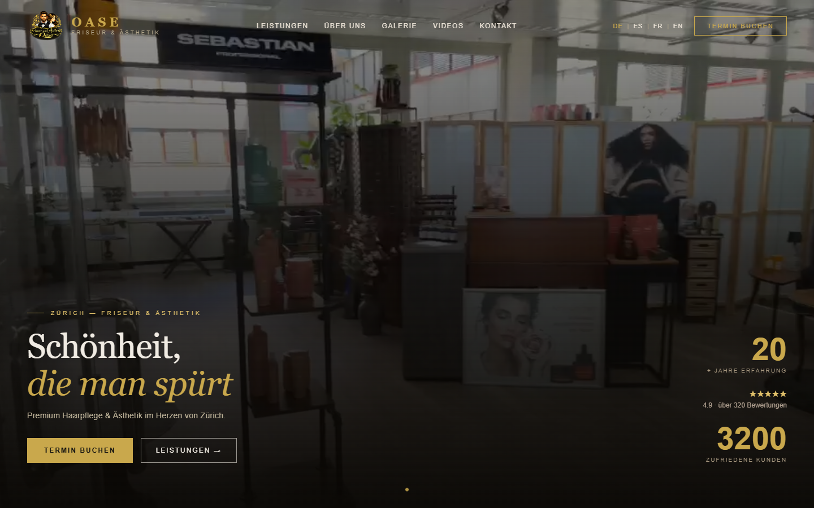
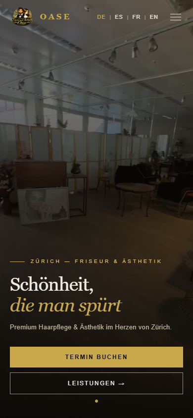
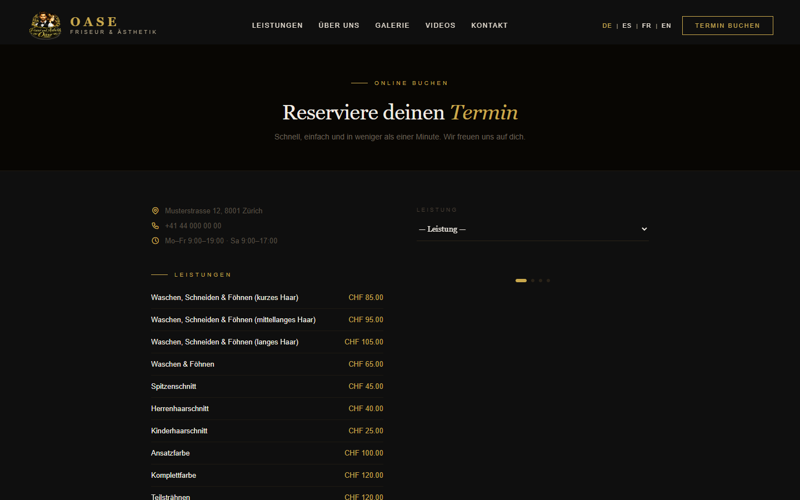
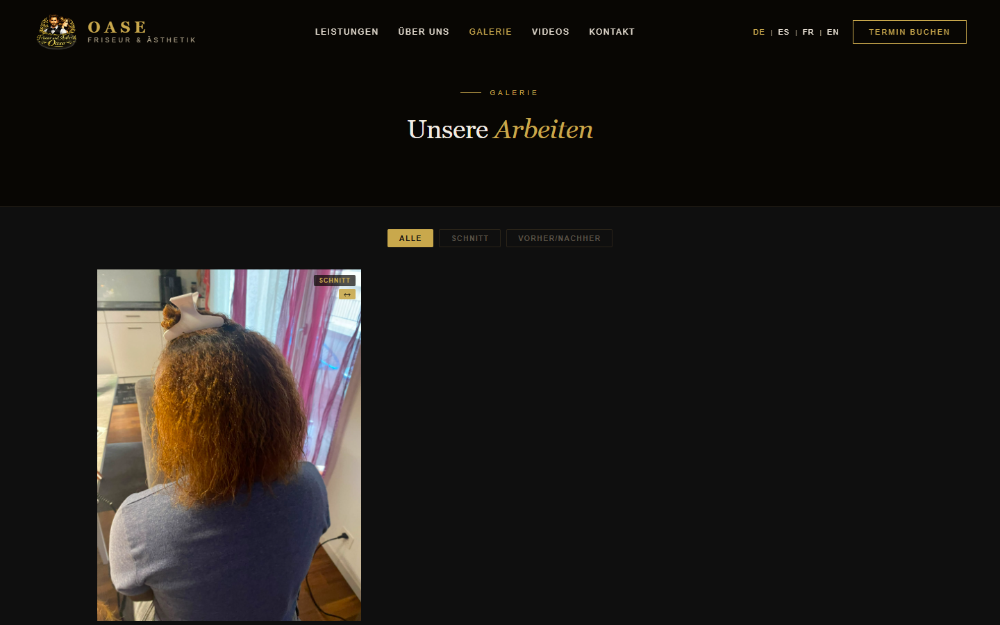

# Oase

Web con reservas en línea para un salón de peluquería y estética en Zúrich. Los clientes ven los servicios y precios, reservan su cita en las horas libres y reciben la confirmación y un recordatorio por correo. El salón gestiona reservas, horarios, servicios, galería y vídeos desde un panel propio. La web está en cuatro idiomas.



## Funcionalidades

**Web pública**
- Portada, servicios con precios, galería de trabajos, vídeos, página "Sobre mí" y contacto.
- Cuatro idiomas: alemán, inglés, español y francés.
- Reserva de cita en pasos: servicio, día y hora libre, calculada según el horario del salón, los días bloqueados y las citas ya reservadas.
- Página "Mi reserva" para consultar o cancelar la cita, y política de cancelación.

**Correos**
- Confirmación de la reserva y recordatorio automático 2 horas antes, enviado por una tarea programada (cron), con PHPMailer y SMTP.

**Panel de administración** (`/admin`)
- Reservas con aviso de las nuevas en tiempo real, para confirmarlas o cancelarlas.
- Horario semanal y bloqueo de días sueltos (vacaciones, festivos).
- Servicios y precios, galería de fotos y vídeos.
- Edición de los textos de la web con traducción automática a los otros idiomas mediante la API de DeepL.

## Tecnologías

| | |
|---|---|
| Backend | PHP 8 sin framework, PDO, Composer |
| Frontend | HTML, CSS, JavaScript, Bootstrap 5 (panel), SweetAlert2 |
| Base de datos | MySQL |
| Servicios | PHPMailer (SMTP), API de DeepL |

## Capturas

| Móvil | Reservar cita | Galería |
|---|---|---|
|  |  |  |

## Instalación local

1. Clonar el repositorio en la carpeta del servidor web (Laragon, XAMPP…) e instalar las dependencias:
   ```bash
   git clone https://github.com/MarcoAfHz/oase.git
   cd oase
   composer install
   ```
2. Crear una base de datos MySQL e importar `data/oase_db.sql`.
3. Copiar `config.example.php` a `config.php` y rellenar la conexión a la base de datos, el correo SMTP y la clave de DeepL.
4. Crear el usuario del panel desde `crear-admin.php` y entrar en `/admin`.
5. En producción, programar el recordatorio cada 15 minutos:
   ```
   */15 * * * * php /ruta/a/oase/api/recordatorio.php
   ```
